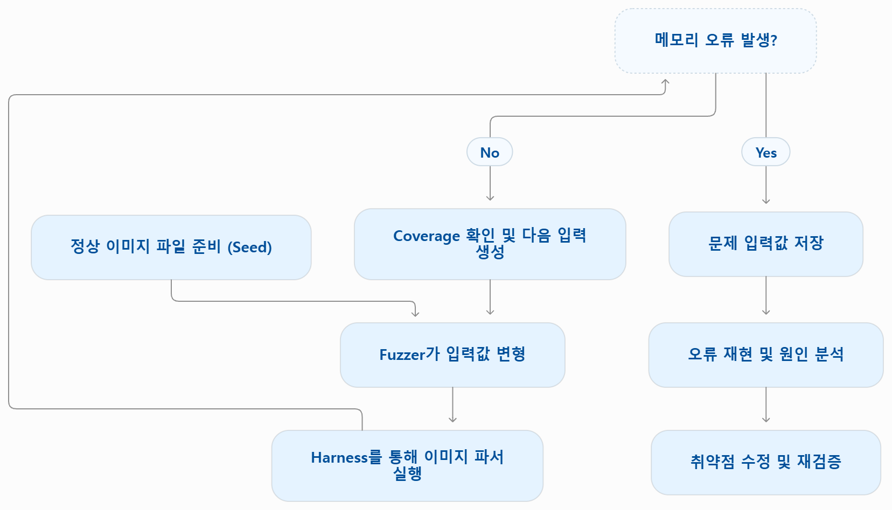
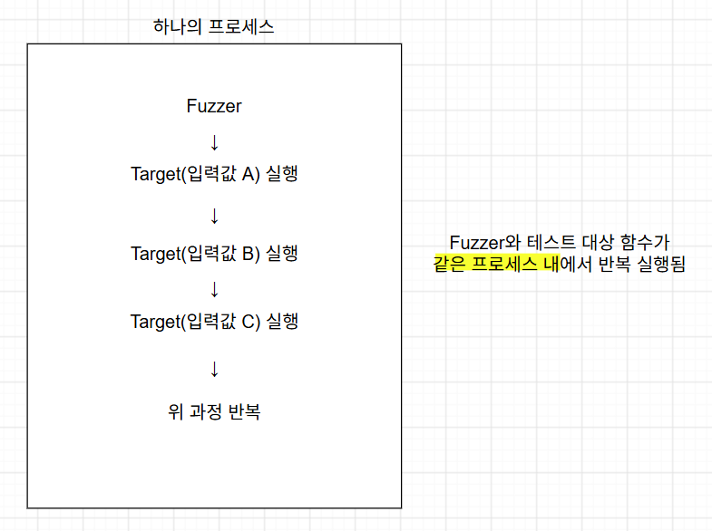
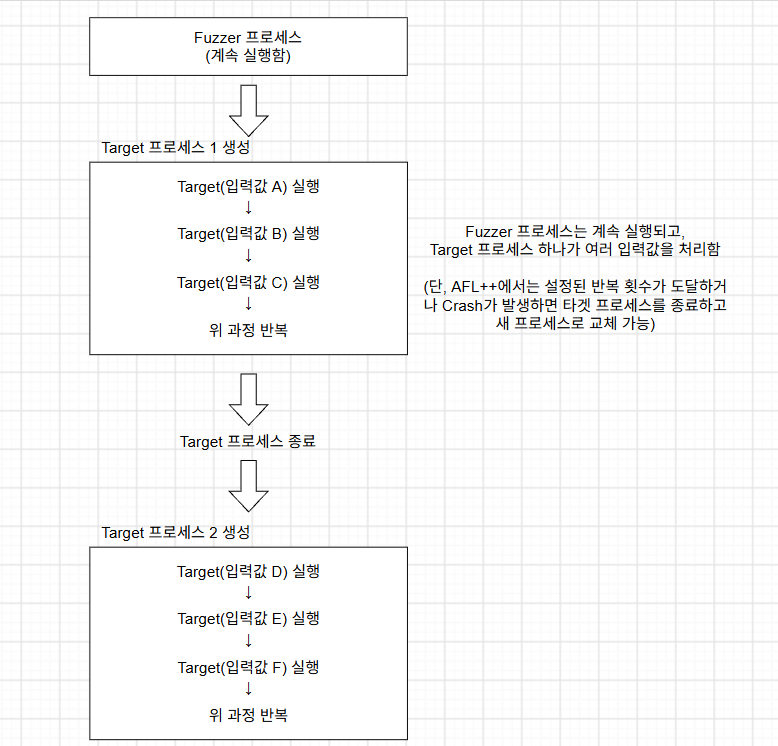

# Fuzzing과 Fuzzer

 

Fuzzing와 Fuzzer가 무엇인지 알아보고 이에 대해 정리해보았습니다.

 
 

## Fuzzing

 

### Fuzzing이란?

 

Fuzzing은 프로그램에 비정상적이거나 예상치 못한 입력값을 반복적으로 전달하여 버그나 취약점을 발견하는 소프트웨어 테스트 기법이다.

퍼징을 통해 취약점을 사전에 탐지하고 수정함으로써 보안을 강화하기 위해 쓰인다.

**brute force(브루트 포스)와의 차이점: 퍼징은 잘못된 형식의 데이터를 보내 서비스의 결합을 유도함 / 브루트 포스는 허용된 값을 찾기 위해 다수의 데이터를 보내는 방식이다.
 
 

#### Fuzzing은 왜 사용하는가?

 

결론부터 말하자면 fuzzing의 최종 목표는 버그/취약점 찾기이다.

다만 취약점을 찾는 과정에서 반복적인 입력이 필요할 때, 이 반복 입력 실행을 자동화하여 정상 테스트 과정에선 찾을 수 없는 취약점을 찾아낸다.

정상 입력뿐 아니라 길이가 지나치게 길거나, 일부 필드가 깨졌거나, 경계값에 걸친 입력을 대량으로 실행해 결함을 찾는다. 충돌, 시간 초과, 메모리 오류, 결과 불일치 등을 관찰한다.

그렇기 때문에 주로 예상치 못한 입력을 받을 수 있는 외부 데이터를 받는 코드에 사용된다. (파일 파서, 이미지 디코더, 네트워크 프로토콜 처리기 등)

(+ AddressSanitizer** 같은 검사 도구와 함께 사용하면 즉시 충돌하지 않는 메모리 오류도 발견할 수 있다.)

**Address Sanitizer(ASan): C/C++ 프로그램이 실행되는 동안 잘못된 메모리 접근이나 메모리 오류를 실시간으로 탐지하는 컴파일러 및 런타임 기반 도구

<aside class="case-callout" markdown="1">

예시 입력

| 입력값 | 테스트 목적 |
| --- | --- |
| `10` | 정상 입력 처리 |
| `0` | 경계값 처리 |
| `-1` | 음수 처리 |
| `2147483648` | 정수 범위 초과 처리 |
| `AAAA` | 잘못된 자료형 처리 |
| 매우 긴 문자열 | 입력 길이 제한 확인 |
| 빈 입력 | 누락된 데이터 처리 |

</aside>
 
 

#### 1-2. 사용 예시

 

예시 상황: 이미지 파일 파서의 BOF 탐지

이미지 파일을 읽고 처리하는 프로그램을 대상으로 퍼징을 수행한다고 가정한다.

정상 이미지 파일 몇 개를 Seed(초기 입력값)로 준비하고, Fuzzer가 이미지 크기 정보나 데이터 바이트를 반복적으로 변형하여 프로그램에 전달한다.

이때 이미지 파서가 데이터 크기를 제대로 검증하지 않는다면 BOF나 OOB 등의 메모리 오류가 발생할 수 있다.

Fuzzer는 이러한 오류를 유발한 입력값을 로그에 저장하고, 개발자는 해당 입력을 다시 실행하여 취약점 발생 원인을 분석한다.
 

 
 

### 2. Fuzzing의 종류

 

퍼징은 하나의 기준으로만 나뉘지 않는다.

크게 네 가지의 축으로 분류할 수 있고, 한 퍼징 설정이 여러 행에 동시에 해당할 수도 있다.

예를 들어 AFL++의 일반적인 사용 형태는 `Grey-box | Mutation-based | Structure-unaware | Coverage-guided` 이다.

| 분류 기준 | 퍼징 기법 | 구분 기준 |
| --- | --- | --- |
| 내부 정보 활용 정도 | Black-box, Grey-box, White-box | 프로그램의 내부 정보를 얼마나 활용하는가? |
| 입력값 생성 방식 | Mutation-based, Generation-based | 입력값을 어떻게 만드는가? |
| 입력 구조 이해 여부 | Structure-unaware, Structure-aware | 입력 형식과 필드 관계를 이해하는가? |
| 실행 결과 활용 방식 | Coverage-guided, 비유도 방식 등 | 실행 결과를 다음 테스트에 어떻게 반영하는가? |
 

내부 정보 활용 정도

- **Black-box**: 내부 코드나 실행 경로 정보를 사용하지 않고, 입력에 대한 외부 동작을 관찰한다.

- **Grey-box**: 커버리지처럼 비교적 가벼운 내부 실행 정보를 사용해 새 경로에 도달한 입력을 우선한다. AFL++와 Jackalope가 대표적인 커버리지 유도 도구다.

- **White-box**: 프로그램의 내부 동작을 깊게 분석하며, 경로 제약을 풀어 특정 실행 경로에 도달할 입력을 찾는 방식 등이 있다. 분석 비용이 클 수 있다.

이 분류는 활용 가능한 내부 정보의 정도를 설명한다. 실제 도구는 계측 방식과 실행 환경에 따라 경계가 명확하지 않을 수 있다.

입력값 생성 방식

- **Mutation-based**(변형 기반): 기존 시드의 바이트를 뒤집거나, 삭제하거나, 다른 입력의 일부를 합쳐 새 입력을 만든다. 시작하기 쉽지만 시드의 품질에 영향을 받는다.

- **Generation-based**(생성 기반): 문법이나 입력 규칙에 따라 처음부터 입력을 만든다. 형식이 복잡한 입력을 유효하게 만들기 쉽지만 규칙을 정의하는 작업이 필요하다.

둘을 섞을 수도 있다. Jackalope는 기본 변형기 외에 문법 기반 변형기를 지원한다.

입력 구조 이해 여부

  
- **Structure-unaware**(구조 비인식): 입력을 주로 바이트 배열로 다룬다. 별도 형식 정의 없이 시작할 수 있지만, 체크섬이나 중첩 구조가 엄격하면 입력이 초기에 거부되기 쉽다.

- **Structure-aware**(구조 인식): 필드, 문법, 길이, 체크섬 등 입력의 구조를 반영한다. 유효한 입력을 유지하며 더 깊은 처리 단계까지 갈 가능성이 높지만 모델이나 전용 변형기를 만들어야 한다.

구조 인식 여부는 생성 기반 여부와 동일하지 않다. 구조를 이해하면서 기존 입력을 변형할 수도 있다.

실행 결과 활용 방식

  
- **Coverage-guided**(커버리지 유도): 실행된 코드나 분기 정보를 피드백으로 받아 새 경로를 보여 준 입력을 보존하고 다시 변형한다. AFL++와 Jackalope가 여기에 해당한다.

- **비유도 방식**: 커버리지 정보를 다음 입력 선택에 사용하지 않는다. 무작위로 입력을 만들거나 정해진 규칙대로 변형해 실행할 수 있다.

커버리지가 늘어도 그것만으로 버그가 발견되었다고 볼 수는 없다. 충돌·검사 도구의 오류 보고·결과 불일치 같은 별도의 판정 기준이 필요하다.

**Code Coverage란? : 소스 코드를 기반으로 하는 화이트박스 테스트를 진행했을 때, 작성한 테스트 코드가 프로덕션 코드(실제 실행 코드)를 얼마나 실행했는지를 백분율(%)로 나타내는 지표

 
 

### 3. Fuzzing의 한계

 

- 복잡한 조건문 또는 검증 로직으로 인한 코드 탐색 한계 
    
&emsp;→ 취약점이 존재하더라도 해당 코드까지 실행되지 않으면 발견할 수 없다.
    
- 취약점 자동 판단 불가 
    
&emsp;→ 크래시가 없는 논리 오류나 권한 검사 실수는 별도의 검증 조건 없이는 놓치기 쉽다.
    
- Path Explosion 및 높은 자원 소모 
    
&emsp;→ 조건 분기가 많아질 수록 실행 경로도 급격하게 증가하여 CPU, 메모리, 실행 시간 등 자원 소모가 커진다. (물론 그럼에도 불구하고 직접 수동 테스트 하는 것보다 퍼징을 사용하는 게 훨씬 시간이 적게 든다…)

 

 

## Fuzzer

 

### 1. Fuzzer란?

 

Fuzzer는 Fuzzing을 자동으로 수행하는 프로그램(도구)를 의미한다.

<aside class="case-callout" markdown="1">

퍼징의 기본 동작 과정

1. **입력값 생성 또는 변형** — 정상 데이터, 비정상 데이터, 경계값 등
2. **Fuzz Target**(퍼징 대상) **실행** — 테스트 대상 프로그램 또는 함수
3. **실행 결과 관찰** — Crash, 메모리 오류, Timeout, 예상과 다른 동작
4. **결과 분석 및 입력값 개선** — 유의미한 입력을 저장하고 다음 테스트에 활용

위 과정을 반복 수행한다.

</aside>

 
 

### 2. Fuzzer의 종류와 차이점

 

| Fuzzer | 주 대상 · 실행 방식 | 입력과 피드백 | 특징 |
|---|---|---|---|
| AFL++ | • 소스 코드가 있는 프로그램과 바이너리, 파일 파서 모두 지원 • Forkserver 기반 | 시드 변형, 커버리지 피드백 | • 커버리지 기반 퍼저로 효율적인 퍼징 가능 • Code Coverage 측정을 위한 코드를 컴파일 타임에 삽입함 |
| Jackalope | Windows·macOS·Linux·Android의 바이너리 대상 | 시드 변형, 커버리지 피드백 | Closed-source 분석, 사용자 정의 및 분산 퍼징에 강점 |
| libFuzzer | C/C++ 함수 및 라이브러리 | 인프로세스 실행, 커버리지 피드백 | `LLVMFuzzerTestOneInput` 하네스를 작성해 함수에 입력 전달함 (특정 함수만 선택해 집중적으로 퍼징 가능) |
| Honggfuzz | 실행 파일, 라이브러리 | 시드 변형, 소프트웨어·하드웨어 커버리지 피드백 | 병렬 실행과 지속 실행 모드 지원 |

 

AFL++

AFL에서 발전한 커버리지 유도 퍼저다.

보통 시드 파일을 변형하고, 실행 결과에서 새 커버리지를 얻은 입력을 코퍼스**에 보존한다. 소스 코드를 다시 빌드해 계측하는 방식 외에도 QEMU·Frida 등 바이너리 대상용 모드를 제공한다. 따라서 **소스가 없으면 AFL++를 쓸 수 없다**고 단정하면 안 된다. 실행 방식과 성능은 선택한 모드에 따라 달라진다.

 **Corpus(코퍼스)란? : 퍼징 대상 프로그램에 입력으로 넣는 유의미한 테스트 케이스(입력 데이터)들의 집합 

Jackalope

구글에서 개발한 바이너리 기반 커버리지 유도 퍼저다. 

소스 코드가 없는 실행 파일(Closed-source Binary)도 퍼징할 수 있다는 점이 특징이다. 또한 TinyInst라는 동적 바이너리 계측 도구를 사용해 커버리지를 수집하고, 이를 이용해 테스트 입력값을 변형한다.

libFuzzer

LLVM 기반의 인프로세스(in-process)** 커버리지 유도 퍼저다. 

개발자가 `LLVMFuzzerTestOneInput(const uint8_t *Data, size_t Size)` 형태의 진입점을 작성하면 퍼저가 그 함수를 여러 입력으로 반복 호출한다. 파서나 라이브러리 함수처럼 작은 단위를 빠르게 시험하기 좋다.

 **인프로세스란? : 현재 실행 중인 프로세스 내부에서 퍼저와 테스트 함수가 함께 동작하는 방식을 의미한다. 

HonggFuzz

커버리지 피드백을 사용해 입력을 발전시키는 범용 퍼저다.

기존 입력을 변형해 대상을 실행하고, 새 실행 경로를 탐색하는 데 유용한 입력을 다음 테스트에 활용한다. 소프트웨어 계측과 지원 환경의 하드웨어 기반 커버리지 수집 방식을 제공한다.

실행 파일에 파일 입력을 전달하는 방식으로 시작할 수 있고, 함수를 같은 프로세스에서 반복 호출하는 지속 실행(persistent) 모드도 지원한다.

지속 실행 모드(persistent mode)와 인프로세스(in-process)의 차이점

| 구분 | In-process | Persistent Mode |
| --- | --- | --- |
| 핵심 개념 | Fuzzer와 테스트 대상이 동일한 프로세스에서 실행 | 하나의 테스트 대상 프로세스에서 여러 입력을 반복 처리 |
| 구분 기준 | Fuzzer와 테스트 대상의 **실행 위치** | 테스트 대상 프로세스의 **재사용 여부** |
| 프로세스 생성 | 입력마다 새 프로세스를 생성하지 않음 | 입력마다 새 프로세스를 생성하지 않음 |
| 대표 도구 | libFuzzer | AFL++, Honggfuzz, Jackalope |
| 주요 장점 | 함수 호출 비용이 낮아 빠른 테스트 가능 | 프로세스 생성 및 초기화 비용 감소 |

사실 이 둘을 찾아보면서도 두 개념의 차이를 영원히 헷갈리는 중이다…

일단 결과만 놓고 보면 두 개념은 배타적이 아니기 때문에 동시에 존재할 수 있다… 왜냐면 서로 다른 기준을 설명하기 때문이다…

지속 실행 모드는 생명 주기(Lifecycle)를, 인프로세스는 실행 위치(Isolation)을 기준으로 두는데… 이게 정리하다보니 헷갈려서 이미지로 정리해보았다.

 
 
 

 

## 참고 페이지

- [AFL++ 저장소](https://github.com/AFLplusplus/AFLplusplus)
- [Jackalope 저장소](https://github.com/googleprojectzero/Jackalope)
- [Google fuzzing 자료 모음](https://github.com/google/fuzzing/tree/master)
- [Google fuzzing: Introduction to fuzzing](https://github.com/google/fuzzing/blob/master/docs/intro-to-fuzzing.md)
- [Google fuzzing: Structure-aware fuzzing](https://github.com/google/fuzzing/blob/master/docs/structure-aware-fuzzing.md)
- [Google fuzzing: Why fuzz?](https://github.com/google/fuzzing/blob/master/docs/why-fuzz.md)
- [Honggfuzz 저장소 및 사용 안내](https://github.com/google/honggfuzz)

